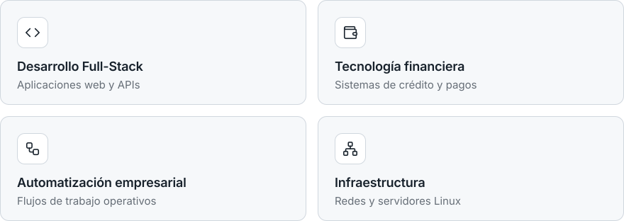
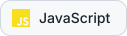
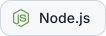
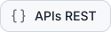
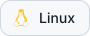
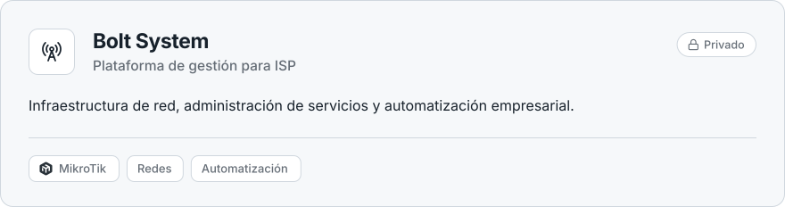
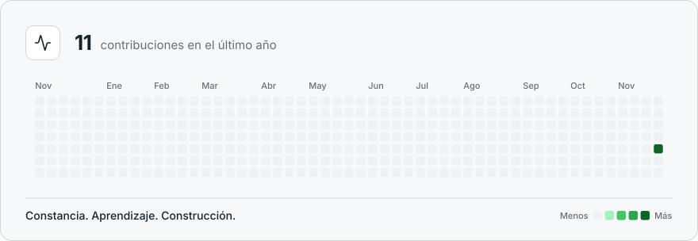
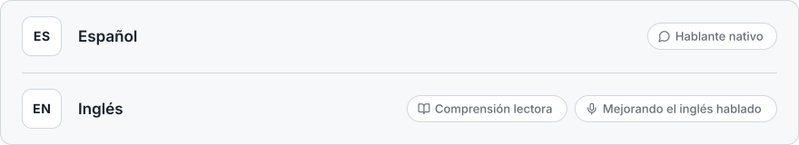

<!-- Design assets: scripts/build-assets.py. Updated automatically every 6 h: the PROJECTS block and assets/statistics (scripts/update-projects.py). -->

<a href="README.md"><picture><source media="(prefers-color-scheme: dark)" srcset="assets/buttons/lang-en-inactive-dark.svg"></picture></a><a href="README.es.md"><picture><source media="(prefers-color-scheme: dark)" srcset="assets/buttons/lang-es-active-dark.svg"></picture></a>

<picture><source media="(prefers-color-scheme: dark)" srcset="assets/banners/banner-es-dark.svg"></picture>

 

### Sobre mí

Desarrollador de software independiente con experiencia práctica en la creación de plataformas financieras, sistemas de gestión empresarial y soluciones de automatización de redes.

<picture><source media="(prefers-color-scheme: dark)" srcset="assets/cards/chip-freelance-es-dark.svg"></picture> <picture><source media="(prefers-color-scheme: dark)" srcset="assets/cards/chip-remote-es-dark.svg"></picture>

 

###### 01 / ÁREAS DE ESPECIALIZACIÓN

<picture><source media="(prefers-color-scheme: dark)" srcset="assets/cards/expertise-es-dark.svg"></picture>

 

###### 02 / STACK TECNOLÓGICO

<picture><source media="(prefers-color-scheme: dark)" srcset="assets/cards/stack/label-frontend-es-dark.svg"></picture>
<picture><source media="(prefers-color-scheme: dark)" srcset="assets/cards/stack/javascript-dark.svg"></picture>
<picture><source media="(prefers-color-scheme: dark)" srcset="assets/cards/stack/react-dark.svg"></picture>
<picture><source media="(prefers-color-scheme: dark)" srcset="assets/cards/stack/tailwindcss-dark.svg"></picture>
<picture><source media="(prefers-color-scheme: dark)" srcset="assets/cards/stack/html5-dark.svg"></picture>
<picture><source media="(prefers-color-scheme: dark)" srcset="assets/cards/stack/css-dark.svg"></picture>

<picture><source media="(prefers-color-scheme: dark)" srcset="assets/cards/stack/label-backend-es-dark.svg"></picture>
<picture><source media="(prefers-color-scheme: dark)" srcset="assets/cards/stack/nodedotjs-dark.svg"></picture>
<picture><source media="(prefers-color-scheme: dark)" srcset="assets/cards/stack/express-dark.svg"></picture>
<picture><source media="(prefers-color-scheme: dark)" srcset="assets/cards/stack/rest-es-dark.svg"></picture>

<picture><source media="(prefers-color-scheme: dark)" srcset="assets/cards/stack/label-databases-es-dark.svg"></picture>
<picture><source media="(prefers-color-scheme: dark)" srcset="assets/cards/stack/postgresql-dark.svg"></picture>
<picture><source media="(prefers-color-scheme: dark)" srcset="assets/cards/stack/supabase-dark.svg"></picture>
<picture><source media="(prefers-color-scheme: dark)" srcset="assets/cards/stack/sqlite-dark.svg"></picture>

<picture><source media="(prefers-color-scheme: dark)" srcset="assets/cards/stack/label-infrastructure-es-dark.svg"></picture>
<picture><source media="(prefers-color-scheme: dark)" srcset="assets/cards/stack/git-dark.svg"></picture>
<picture><source media="(prefers-color-scheme: dark)" srcset="assets/cards/stack/linux-dark.svg"></picture>
<picture><source media="(prefers-color-scheme: dark)" srcset="assets/cards/stack/cloudflare-dark.svg"></picture>
<picture><source media="(prefers-color-scheme: dark)" srcset="assets/cards/stack/mikrotik-dark.svg"></picture>

 

###### 03 / PROYECTOS DESTACADOS

<picture><source media="(prefers-color-scheme: dark)" srcset="assets/cards/project-credi-mujer-es-dark.svg"></picture>

<picture><source media="(prefers-color-scheme: dark)" srcset="assets/cards/project-bolt-system-es-dark.svg"></picture>

Proyectos privados: no se publica código fuente, credenciales ni datos de clientes.

<!-- PROJECTS:START -->
<!-- PROJECTS:END -->

<a href="https://github.com/A-L-Z?tab=repositories"><picture><source media="(prefers-color-scheme: dark)" srcset="assets/buttons/explore-es-dark.svg"></picture></a>

 

###### 04 / ACTIVIDAD DE DESARROLLO

<picture><source media="(prefers-color-scheme: dark)" srcset="assets/statistics/activity-es-dark.svg"></picture>

 

###### 05 / IDIOMAS

<picture><source media="(prefers-color-scheme: dark)" srcset="assets/cards/languages-es-dark.svg"></picture>

 

<a href="https://github.com/A-L-Z"><picture><source media="(prefers-color-scheme: dark)" srcset="assets/cards/availability-es-dark.svg"></picture></a>

 

<b>A&nbsp;&nbsp;—&nbsp;&nbsp;L&nbsp;&nbsp;—&nbsp;&nbsp;Z</b> Software. Ingeniería. Innovación.

