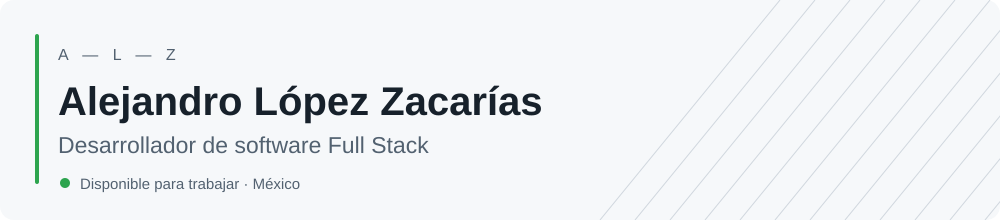
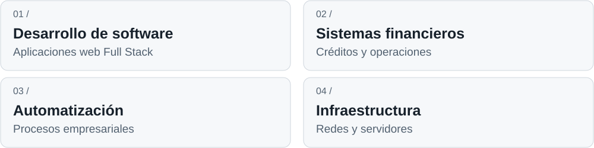
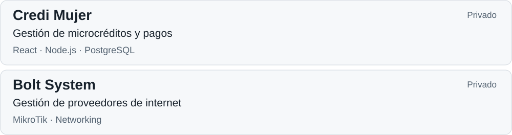

 

<picture><source media="(prefers-color-scheme: dark)" srcset="assets/banner-es-dark.svg"></picture>

### Software con propósito.

Desarrollador independiente en México. Creo soluciones digitales para operaciones financieras, automatización empresarial e infraestructura de redes.

## 01 / Especialidades

<picture><source media="(prefers-color-scheme: dark)" srcset="assets/expertise-es-dark.svg"></picture>

## 02 / Tecnologías

           

## 03 / Experiencia aplicada

<picture><source media="(prefers-color-scheme: dark)" srcset="assets/work-es-dark.svg"></picture>

Proyectos privados; no se publica código ni información de clientes.

## 04 / Proyectos públicos

<!-- PROJECTS:START -->
Próximamente nuevos proyectos públicos.

[Explorar todos los repositorios](https://github.com/A-L-Z?tab=repositories)
<!-- PROJECTS:END -->

## 05 / Trabajemos juntos

Disponible para oportunidades de desarrollo de software remotas y presenciales. Español nativo; inglés de lectura, expresión oral en aprendizaje.

---

A-L-Z · Software with purpose.

