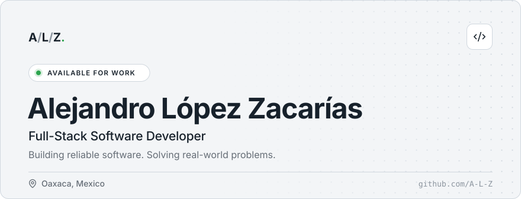
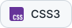
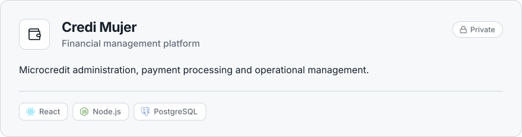
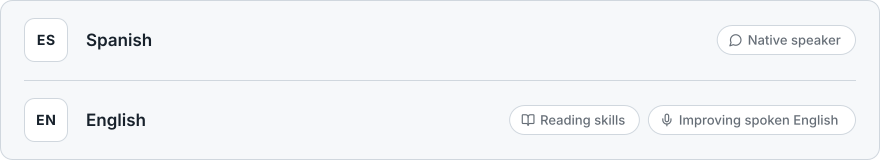

<!-- Design assets: scripts/build-assets.py. Updated automatically every 6 h: the PROJECTS block and assets/statistics (scripts/update-projects.py). -->

<a href="README.md"><picture><source media="(prefers-color-scheme: dark)" srcset="assets/buttons/lang-en-active-dark.svg"></picture></a><a href="README.es.md"><picture><source media="(prefers-color-scheme: dark)" srcset="assets/buttons/lang-es-inactive-dark.svg"></picture></a>

<picture><source media="(prefers-color-scheme: dark)" srcset="assets/banners/banner-en-dark.svg"></picture>

 

### About me

Independent software developer with hands-on experience building financial platforms, business management systems and network automation solutions.

<picture><source media="(prefers-color-scheme: dark)" srcset="assets/cards/chip-freelance-en-dark.svg"></picture> <picture><source media="(prefers-color-scheme: dark)" srcset="assets/cards/chip-remote-en-dark.svg"></picture>

 

###### 01 / AREAS OF EXPERTISE

<picture><source media="(prefers-color-scheme: dark)" srcset="assets/cards/expertise-en-dark.svg"></picture>

 

###### 02 / TECHNOLOGY STACK

<picture><source media="(prefers-color-scheme: dark)" srcset="assets/cards/stack/label-frontend-en-dark.svg"></picture>
<picture><source media="(prefers-color-scheme: dark)" srcset="assets/cards/stack/javascript-dark.svg"></picture>
<picture><source media="(prefers-color-scheme: dark)" srcset="assets/cards/stack/react-dark.svg"></picture>
<picture><source media="(prefers-color-scheme: dark)" srcset="assets/cards/stack/tailwindcss-dark.svg"></picture>
<picture><source media="(prefers-color-scheme: dark)" srcset="assets/cards/stack/html5-dark.svg"></picture>
<picture><source media="(prefers-color-scheme: dark)" srcset="assets/cards/stack/css-dark.svg"></picture>

<picture><source media="(prefers-color-scheme: dark)" srcset="assets/cards/stack/label-backend-en-dark.svg"></picture>
<picture><source media="(prefers-color-scheme: dark)" srcset="assets/cards/stack/nodedotjs-dark.svg"></picture>
<picture><source media="(prefers-color-scheme: dark)" srcset="assets/cards/stack/express-dark.svg"></picture>
<picture><source media="(prefers-color-scheme: dark)" srcset="assets/cards/stack/rest-en-dark.svg"></picture>

<picture><source media="(prefers-color-scheme: dark)" srcset="assets/cards/stack/label-databases-en-dark.svg"></picture>
<picture><source media="(prefers-color-scheme: dark)" srcset="assets/cards/stack/postgresql-dark.svg"></picture>
<picture><source media="(prefers-color-scheme: dark)" srcset="assets/cards/stack/supabase-dark.svg"></picture>
<picture><source media="(prefers-color-scheme: dark)" srcset="assets/cards/stack/sqlite-dark.svg"></picture>

<picture><source media="(prefers-color-scheme: dark)" srcset="assets/cards/stack/label-infrastructure-en-dark.svg"></picture>
<picture><source media="(prefers-color-scheme: dark)" srcset="assets/cards/stack/git-dark.svg"></picture>
<picture><source media="(prefers-color-scheme: dark)" srcset="assets/cards/stack/linux-dark.svg"></picture>
<picture><source media="(prefers-color-scheme: dark)" srcset="assets/cards/stack/cloudflare-dark.svg"></picture>
<picture><source media="(prefers-color-scheme: dark)" srcset="assets/cards/stack/mikrotik-dark.svg"></picture>

 

###### 03 / SELECTED PROJECTS

<picture><source media="(prefers-color-scheme: dark)" srcset="assets/cards/project-credi-mujer-en-dark.svg"></picture>

<picture><source media="(prefers-color-scheme: dark)" srcset="assets/cards/project-bolt-system-en-dark.svg"></picture>

Private projects: source code, credentials and customer data are not published.

<!-- PROJECTS:START -->
<!-- PROJECTS:END -->

<a href="https://github.com/A-L-Z?tab=repositories"><picture><source media="(prefers-color-scheme: dark)" srcset="assets/buttons/explore-en-dark.svg"></picture></a>

 

###### 04 / DEVELOPMENT ACTIVITY

<picture><source media="(prefers-color-scheme: dark)" srcset="assets/statistics/activity-en-dark.svg"></picture>

 

###### 05 / LANGUAGES

<picture><source media="(prefers-color-scheme: dark)" srcset="assets/cards/languages-en-dark.svg"></picture>

 

<a href="https://github.com/A-L-Z"><picture><source media="(prefers-color-scheme: dark)" srcset="assets/cards/availability-en-dark.svg"></picture></a>

 

<b>A&nbsp;&nbsp;—&nbsp;&nbsp;L&nbsp;&nbsp;—&nbsp;&nbsp;Z</b> Software. Engineering. Innovation.

