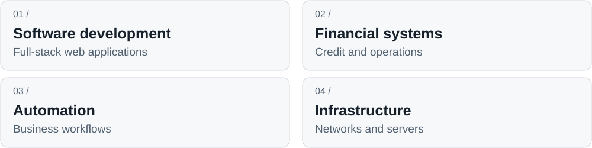
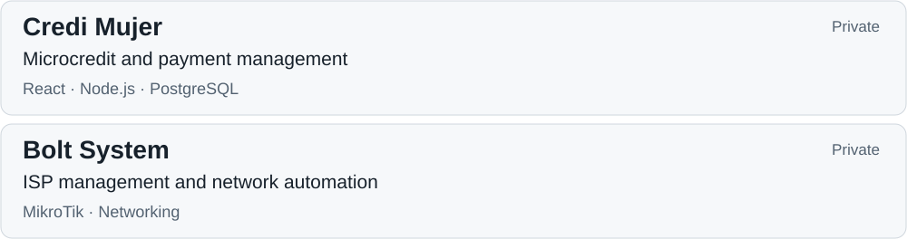

 

<picture><source media="(prefers-color-scheme: dark)" srcset="assets/banner-en-dark.svg"></picture>

### Software with purpose.

Independent developer in Mexico. I build digital solutions for financial operations, business automation and network infrastructure.

## 01 / Expertise

<picture><source media="(prefers-color-scheme: dark)" srcset="assets/expertise-en-dark.svg"></picture>

## 02 / Technology stack

           

## 03 / Selected work

<picture><source media="(prefers-color-scheme: dark)" srcset="assets/work-en-dark.svg"></picture>

Private projects; source code and customer information are not published.

## 04 / Public projects

<!-- PROJECTS:START -->
New public projects coming soon.

[Explore all repositories](https://github.com/A-L-Z?tab=repositories)
<!-- PROJECTS:END -->

## 05 / Let's work together

Open to remote and on-site software development opportunities. Native Spanish; English reading skills, developing spoken proficiency.

---

A-L-Z · Software with purpose.

