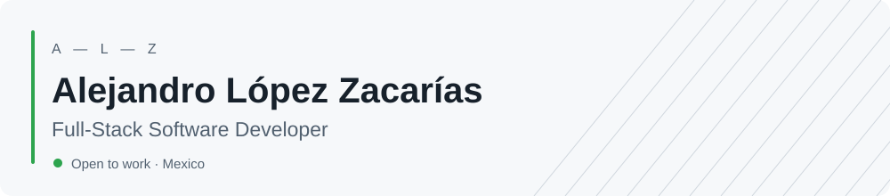

**English** &nbsp;·&nbsp; [Español](README.es.md)

<picture>
  <source media="(prefers-color-scheme: dark)" srcset="assets/banner-en-dark.svg">
  
</picture>

### Software with purpose.

Independent developer in Mexico building practical solutions for financial operations, business automation and network infrastructure.

[Explore repositories](https://github.com/A-L-Z?tab=repositories) · [Contact via GitHub](https://github.com/A-L-Z)

---

### 01 / About me

I design, develop and deploy full-stack applications that address operational challenges. My experience includes financial workflows, database-backed services, Linux deployments and ISP network automation.

### 02 / Applied experience

| Work | What I build | Visibility |
| --- | --- | --- |
| **Credi Mujer** | Microcredit administration, payment tracking and business operations | Private |
| **Bolt System** | ISP administration and network automation workflows | Private |

*These are real-world projects. Their private source code and customer information are not published here.*

### 03 / Technology stack

**Frontend** · JavaScript · React · HTML5 · CSS3 · Tailwind CSS

**Backend** · Node.js · Express · REST APIs

**Databases / Bases de datos** · PostgreSQL · SQLite · Supabase

**Infrastructure / Infraestructura** · Linux · Git · Cloudflare · MikroTik

### 04 / Public repositories

<!-- PROJECTS:START -->
New public projects coming soon.

[Explore all repositories](https://github.com/A-L-Z?tab=repositories)
<!-- PROJECTS:END -->

### 05 / Opportunities

Open to software development roles, remote or on-site opportunities and professional collaborations.

**Languages:** Spanish (native) · English (reading; developing spoken proficiency).

---

A-L-Z · Building software that solves real problems.

